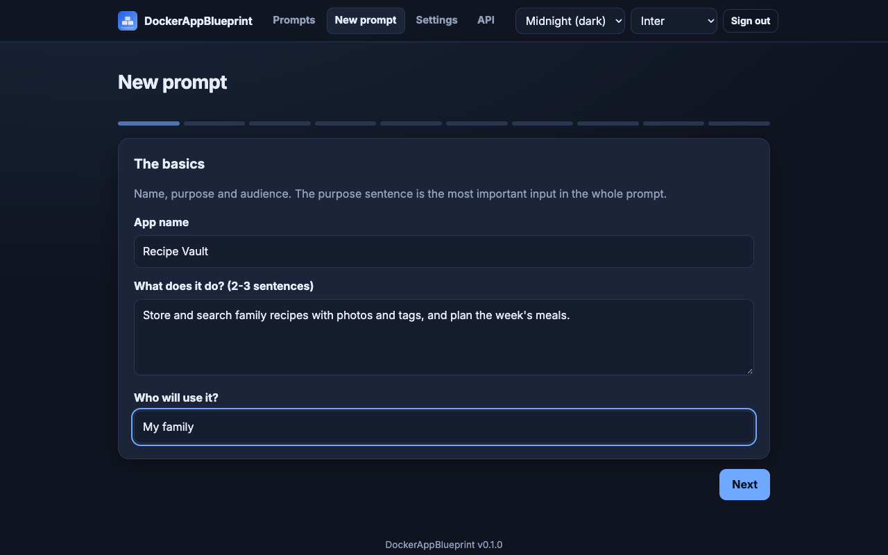
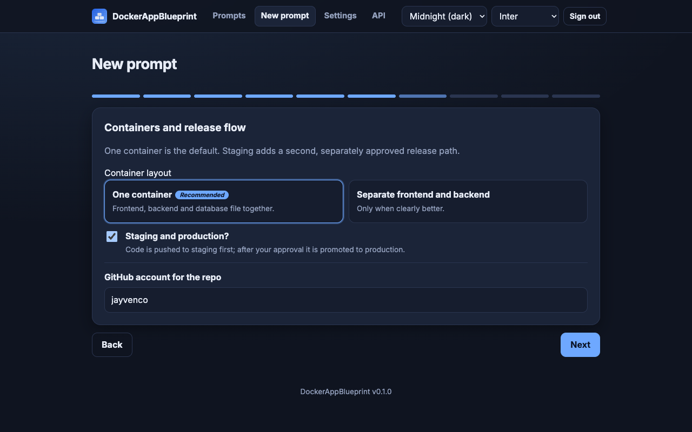
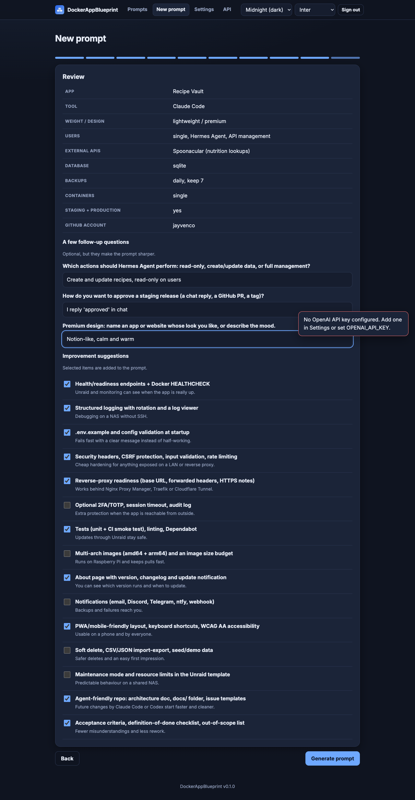
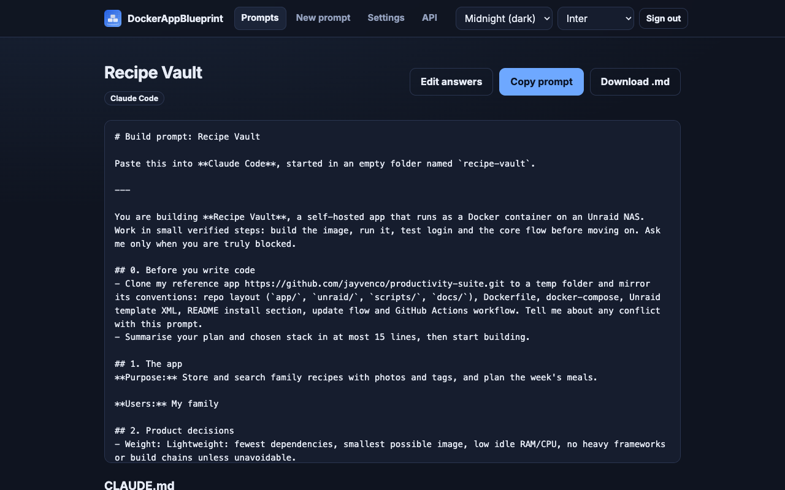
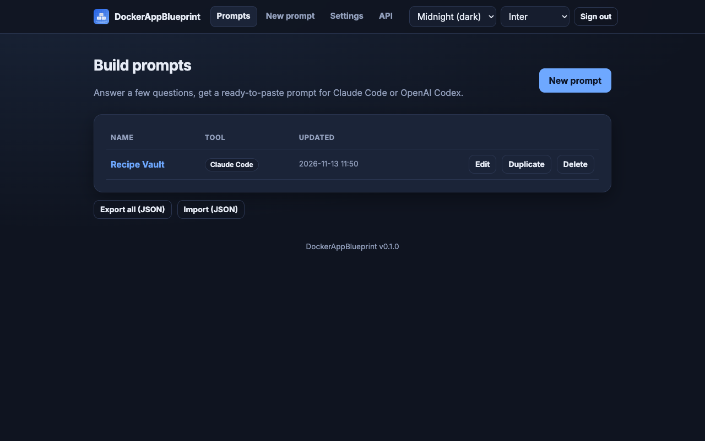
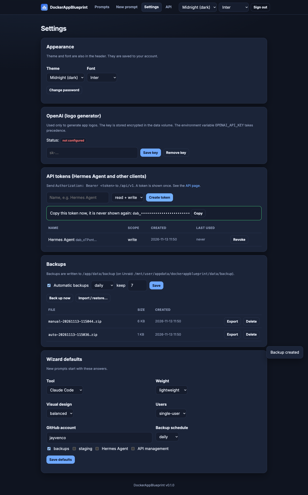
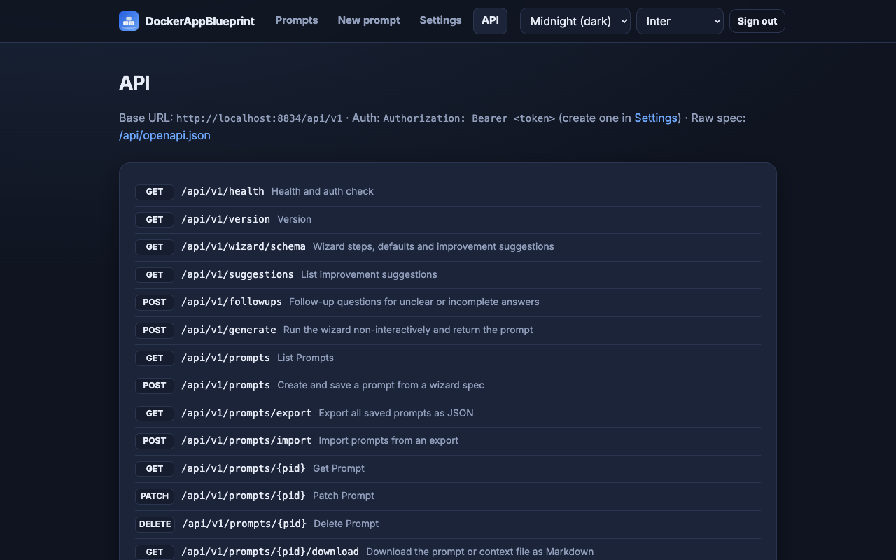
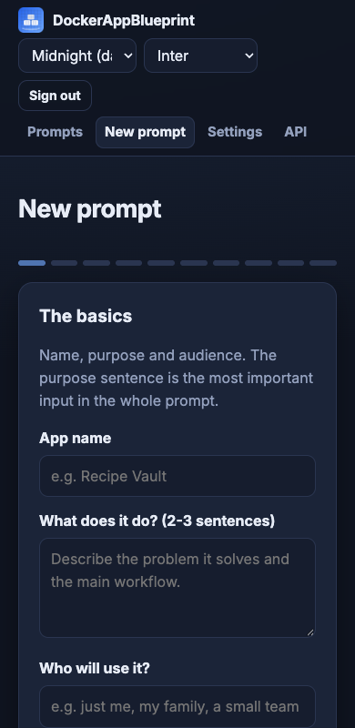
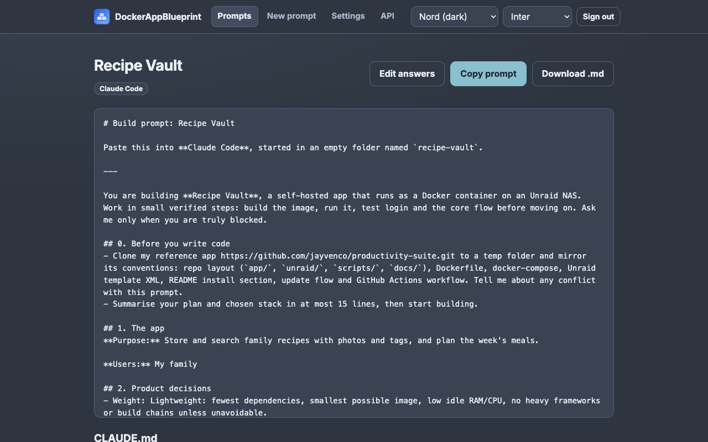
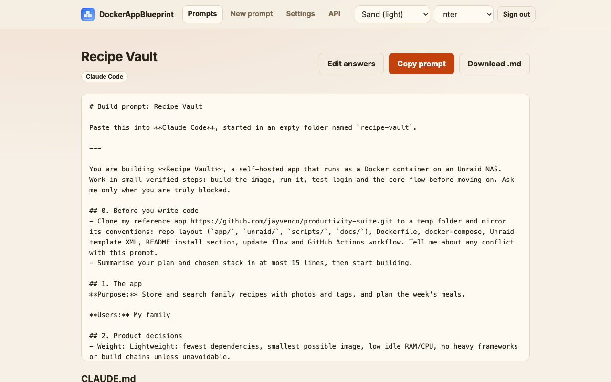

<p align="center"></p>

# DockerAppBlueprint

A lightweight, self-hosted wizard that turns a few answers into a **ready-to-paste build prompt** for creating new Docker-hosted apps with **Claude Code** or **OpenAI Codex**. Every generated prompt bakes in the same house rules: one container, SQLite, login with a forced password change, 5 themes, 5 fonts, Unraid template, GHCR image, its own GitHub repo, automatic docs and screenshots.

Single container, SQLite, runs on Unraid. Python 3.12 + FastAPI, about 300 MB image.

## Screenshots

*All screenshots use demo data.*

| | |
|---|---|
| **Wizard** — one question at a time, "Recommended" marked<br> | **Staging question** — asked per app<br> |
| **Review** — follow-up questions and improvement suggestions<br> | **Generated prompt** — copy or download, plus `CLAUDE.md`/`AGENTS.md`<br> |
| **Prompt history** — edit, duplicate, delete, import/export<br> | **Settings** — OpenAI key, API tokens, backups, defaults<br> |
| **API docs** — works offline<br> | **Mobile**<br> |
| **Theme Nord**<br> | **Theme Sand**<br> |

## Features

- **Wizard**: name/purpose, target tool, lightweight/balanced/feature-rich, minimal/balanced/premium design, single/multi-user, Hermes Agent, API management, external APIs (and what they are for), database, backups, containers, staging/production, extra wishes. Unclear answers trigger **follow-up questions**.
- **Improvement suggestions** (toggleable): health checks, logging, security headers, reverse-proxy readiness, 2FA, tests/CI, multi-arch, notifications, PWA/accessibility, data tools, agent-friendly repo, acceptance criteria and more.
- **Tool-specific output**: Claude Code (prompt + `CLAUDE.md`) or OpenAI Codex (prompt + `AGENTS.md`).
- **Prompt history** with edit, duplicate, delete and JSON import/export.
- **Logo generator** (OpenAI images): generate variants, pick one, download PNG and a 256px icon.
- **REST API for Hermes Agent**: Bearer tokens with read or write scope, OpenAPI spec, offline docs page. See [AGENT_API.md](AGENT_API.md).
- **Security**: password login (bcrypt), default `admin`/`admin` with forced change, rate-limited sign-in, Origin/CSRF check, security headers and a strict CSP.
- **5 themes** (Daylight, Midnight, Nord, Sand, Forest) and **5 fonts** (Inter, Roboto, Open Sans, Lato, System UI), bundled locally, no CDN.
- **Backups**: automatic daily/weekly backups into `backup/`, retention, export, import/restore (with a safety copy first).

## What every generated prompt enforces

English UI and docs · lightweight single container · SQLite by default (other engines only with a reason) · login `admin`/`admin` with forced change · 5 themes + 5 fonts · `/mnt/user/appdata/<app>/data` volume and an Unraid Community Applications template · updates by pulling the image in Unraid · GHCR image via GitHub Actions · a new repo under `jayvenco` · README/CHANGELOG/API docs and screenshots updated automatically · optional `develop`/`main` staging flow with an approval step · structure modelled on [productivity-suite](https://github.com/jayvenco/productivity-suite).

## Install

### Unraid (template)
1. Copy `unraid/dockerappblueprint.xml` to `/boot/config/plugins/dockerMan/templates-user/` (or install with the script below).
2. Docker tab → **Add Container** → pick the `dockerappblueprint` template → Apply.
3. Open `http://<unraid-ip>:8834/`, sign in with `admin` / `admin` and set a new password.

Data lives in `/mnt/user/appdata/dockerappblueprint/data` (database, `backup/`, logos, session key).

### Unraid (one command)
```bash
bash scripts/install-unraid.sh
```
The image is published by GitHub Actions as `ghcr.io/jayvenco/dockerappblueprint:latest` (set the package to **Public** after the first build, or pass `GHCR_USER`/`GHCR_TOKEN`). The script pulls it, creates the container with Unraid labels and writes the template. Variables: `HOST_PORT`, `APPDATA`, `IMAGE_TAG`, `CONTAINER_NAME`.

### docker compose
```bash
docker compose up --build
```
Open http://localhost:8834. Data is stored in `./data`.

### docker run
```bash
docker run -d --name dockerappblueprint -p 8834:8000 \
  -v /mnt/user/appdata/dockerappblueprint/data:/app/data \
  -e TZ=Europe/Amsterdam --restart unless-stopped \
  ghcr.io/jayvenco/dockerappblueprint:latest
```

## Updating
Unraid: Docker tab → *Check for updates* / *force update* (or run the install script again). Data stays in the volume.

## Staging and production
`develop` publishes `:staging`, `main` publishes `:latest`. Staging has its own template (`unraid/dockerappblueprint-staging.xml`, port 8934, appdata `dockerappblueprint-staging`). Install it with `CONTAINER_NAME=dockerappblueprint-staging IMAGE_TAG=staging HOST_PORT=8934 bash scripts/install-unraid.sh`. Promote by merging `develop` into `main` after approval.

## Configuration
Everything works without configuration. Optional environment variables:

| Variable | Purpose |
|---|---|
| `TZ`, `PUID`, `PGID` | Timezone and the user the app runs as (Unraid default 99:100) |
| `OPENAI_API_KEY` | Logo generator key (overrides the key in Settings) |
| `OPENAI_IMAGE_MODEL`, `OPENAI_BASE_URL` | Image model (default `gpt-image-1`) and API base URL |
| `DEFAULT_THEME` | Theme for a fresh install |
| `BACKUP_ENABLED`, `BACKUP_KEEP` | Backup defaults for a fresh install (changeable in Settings) |
| `COOKIE_SECURE` | `true` forces Secure cookies (HTTPS-only setups) |

Behind a reverse proxy, forward `X-Forwarded-For`, `X-Forwarded-Proto` and `Host`.

## Backups
Settings → Backups. Automatic backups go to `/app/data/backup` as `auto-<time>.zip` (database via the SQLite online backup API, plus logos). *Export* downloads a zip, *Import / restore* replaces the current data after writing a `before-restore-*.zip` safety copy; you then sign in again. Retention only counts normal backups, never safety copies.

## API
Create a token under Settings → API tokens and call `/api/v1` with `Authorization: Bearer <token>`. Docs page: `/api/docs`, spec: `/api/openapi.json`, handbook: [AGENT_API.md](AGENT_API.md).

## Development
```bash
python3.12 -m venv .venv && ./.venv/bin/pip install -r requirements-dev.txt
./.venv/bin/uvicorn app.main:app --reload      # http://localhost:8000
./.venv/bin/python -m pytest -q                # tests
```

## Architecture
`app/main.py` (app, middleware) · `app/routers/` (`pages`, `api`, `ui`) · `app/services/wizard.py` (questions, defaults, improvements) · `app/services/promptgen.py` (prompt text) · `backup.py`, `logos.py`, `store.py` · `app/static/` (CSS themes, JS, fonts). Details for agents: [CLAUDE.md](CLAUDE.md).
